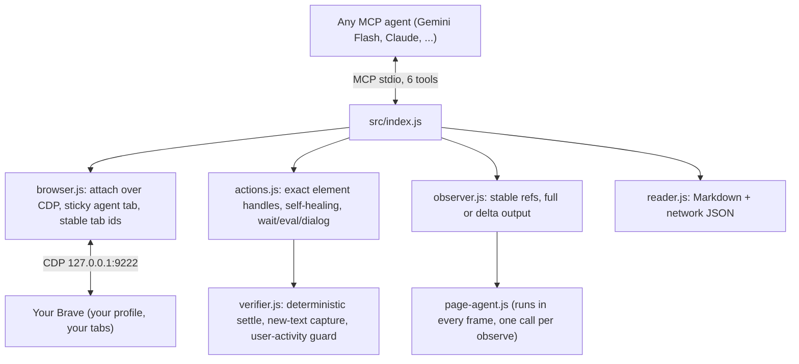

# Brave Co-Browsing Agent (`brave-mcp`)

[](https://modelcontextprotocol.io/)
[](https://playwright.dev/)
[](#-quick-start)

An MCP server that lets an AI agent (Gemini, Claude, Antigravity, Cursor, any MCP client) work in **your already-open browser at the same time as you**: same logins, same tabs, no second browser. It works the same way on every website and is tuned for small, fast models: minimum tokens per step, fewest round trips.

---

## How it works



### What makes it fast and cheap

| | Before (v1) | Now (v2) |
| :--- | :--- | :--- |
| Tool schemas sent every request | ~3,700 tokens (8 tools) | **~1,740 tokens** (6 tools) |
| Reply after an action | full element list (~350–1,500 tokens) | **only what changed** (often 5–60 tokens) |
| CDP round trips per click | ~14 sequential | **~4** (one in-page call observes all of a frame) |
| Observe, real sites (avg of 12) | n/a | **26 ms**, ~356 tokens |
| Element targeting | rebuilt CSS path (wrong element on repeated labels) | **exact element handle**, stable across observations |

- **Delta replies.** Refs like `e12` stay valid for the element's lifetime. After an action the agent gets `+` new elements, `~` changed ones, `-` gone ones, and `text: "Saved"` for new page text, instead of the whole page again.
- **No-observe actions.** `ref` also accepts visible text (`"Sign in"`), `role:text` (`"button:Save"`) or `css:#id`, so known flows don't need an observe call at all.
- **One call for whole flows.** `brave_act` takes `steps` (goto, type, select, click, wait, eval...). It stops at the first failure and returns the current state, so the agent can recover without an extra call.
- **Deterministic settle.** It waits for "no DOM mutations for 150 ms and no same-site XHR/fetch in flight", polling from Node, so it works in background tabs where page timers are throttled. Ads and trackers are ignored.
- **Network reading.** `brave_read network:true` lists the JSON the site itself loaded; `response:n` returns one body. On app-like sites this is often 10× cheaper than reading the page.
- **Modal focus.** When a modal dialog is open, observation lists only the modal.

### Built for sharing the browser with you

- **The agent keeps its own tab.** You can switch tabs freely; the agent keeps working where it was. New tabs open in the background. It never steals focus unless asked (`focus`).
- **Stable tab ids** (`t1`, `t2`...) survive you opening, closing and reordering tabs.
- **Your dialogs stay yours.** Plain Playwright auto-dismisses every `alert/confirm` (and auto-accepts "Leave site?") in all your tabs while connected. This server keeps them open for you. Only dialogs caused by the agent's own actions are answered, and each one is reported.
- **Your downloads stay yours.** It attaches with `noDefaults`, so downloads keep going to your normal folder (they are reported, not redirected).
- **It won't type over you.** If you're typing or clicking in the agent's tab, it waits for you to pause (up to 2.5 s) or tells the model you're busy.
- **You can see what it touches.** A brief purple outline flashes on each element the agent acts on (`BRAVE_MCP_HIGHLIGHT=0` to disable).

### Works on any website

There is no site-specific code. Handled generically: shadow DOM, same- and cross-origin iframes, React/Vue click handlers on plain `<div>`s (detected via `cursor:pointer`), hidden styled checkboxes (clicked via their label), custom dropdowns, custom upload buttons (native file chooser), `contenteditable` editors, SPAs that scroll inside a `<div>`, `display:contents` layouts, whole-page `<form>` sites (ASP.NET, portals), and consent banners in 12+ languages, where it prefers **reject / necessary-only** first. Tested against Wikipedia, GitHub, MDN, BBC, DuckDuckGo, YouTube, Amazon, w3schools, gov.uk and Hacker News (`node test/bench-sites.js`).

---

## 🚀 Quick start

1. **`setup.cmd`** installs dependencies and registers `brave-control` in `~/.gemini/config/mcp_config.json`.
2. **`launch.cmd`** (or `brave-launcher\launch-brave.cmd`) starts Brave, Chrome or Edge with remote debugging on port 9222, using your normal profile and restoring your session. If the port is already open it does nothing.

> [!WARNING]
> **Never add `--remote-allow-origins=*`.** It lets any website you visit connect to the debugging port and control your logged-in browser. This server connects from Node and doesn't need it. Older versions of these launchers added it: if you started Brave that way, restart it with the current launcher (and re-run `create-connected-shortcut.ps1` if you use the desktop shortcut).

The launchers also pass `--disable-background-timer-throttling --disable-renderer-backgrounding`, so sites keep responding at full speed while the agent works in a background tab.

### Register with any MCP client

```json
{ "mcpServers": { "brave-control": { "command": "node", "args": ["<repo>/brave-mcp/src/index.js"] } } }
```

- Claude Code: `claude mcp add brave-control node <repo>/brave-mcp/src/index.js`
- Antigravity on Windows can also use `cmd.exe /c <repo>\brave-mcp\run-mcp.cmd`.
- The server sends its own usage rules in the MCP `instructions` field, so the agent knows the workflow without any extra prompt.

### macOS / Linux

```bash
"/Applications/Brave Browser.app/Contents/MacOS/Brave Browser" --remote-debugging-port=9222 --restore-last-session
brave-browser --remote-debugging-port=9222 --restore-last-session
curl http://127.0.0.1:9222/json/version
```

### Browser on another machine

Don't expose port 9222 on your network (anyone who can reach it controls the browser). Tunnel it instead, then point the server at the tunnel:

```bash
ssh -N -L 9222:127.0.0.1:9222 user@machine-a
CDP_URL=http://127.0.0.1:9222 node brave-mcp/src/index.js
```

---

## 🛠️ The 6 tools

| Tool | Purpose | Main parameters |
| :--- | :--- | :--- |
| `brave_tabs` | list / switch / new / close / focus | `action`, `tab`, `url` |
| `brave_observe` | interactive elements, viewport first | `scope`, `filter`, `max`, `visible_only`, `screenshot`, `labels`, `crop` |
| `brave_read` | page as Markdown, or the site's network JSON | `scope`, `offset`, `max`, `network`, `response` |
| `brave_act` | one action or `steps`, then a delta | `action`, `ref`, `text`, `enter`, `value`, `key`, `files`, `xy`, `to`, `url`, `dir`, `gone`, `ms`, `script`, `accept`, `steps`, `observe` |
| `brave_eval` | run JS, get JSON back (bulk extraction) | `script`, `frame` |
| `brave_workflow` | loops with no LLM turns | `paginate_extract`, `bulk_action`, `run_script` |

`tab` accepts a tab id (`t3`), an index, or URL/title text. Omit it to stay on the agent's tab.

**Observation format**

```text
# Checkout | shop.example.com/cart | t2 | y0/2400 | modal "Sign in"
! Card number is invalid
e3 textbox:email "Email" ="ada@example.com"
e4 checkbox "Remember me" [checked]
e5 button "Continue" [disabled]
below:
e9 link "Privacy"
```

**Actions:** `click`, `type`, `press`, `select`, `upload`, `hover`, `scroll`, `drag`, `goto`, `back`, `forward`, `reload`, `wait` (`text` / `gone` / `ref` / `url` / `ms`), `eval`, `dialog` (`accept`).

**Example: a whole login in one call**

```json
{ "steps": [
  { "action": "goto", "url": "example.com/login" },
  { "action": "type", "ref": "Email", "text": "ada@example.com" },
  { "action": "click", "ref": "button:Continue" },
  { "action": "wait", "text": "Welcome" }
] }
```

Old tool names (`brave_batch_act`, `brave_navigate`) and old parameter names (`tabIndex`, `coordinate`, `pressEnter`, `filePaths`, `select_option`...) still work; they're just not advertised, so they cost no tokens.

---

## 📁 Repository structure

```text
Browser-remastered/
├── brave-mcp/
│   ├── run-mcp.cmd              # launcher used by mcp_config.json
│   ├── src/
│   │   ├── index.js             # MCP server: 6 tools, instructions, legacy aliases
│   │   ├── browser.js           # CDP attach (noDefaults), sticky agent tab, tab ids, background tabs
│   │   ├── page-agent.js        # in-page observer: refs, deltas, modal scope, text capture, user activity
│   │   ├── page-hooks.js        # per-tab hooks: in-flight requests, network log, dialogs, popups, downloads
│   │   ├── observer.js          # stable ref registry across frames, full/delta formatting, screenshots
│   │   ├── actions.js           # action engine on element handles, self-healing fallbacks
│   │   ├── verifier.js          # action bracket: settle, receipts, side effects
│   │   ├── reader.js            # Markdown extraction (shadow DOM aware, paged)
│   │   ├── workflow.js          # pagination, bulk actions, script runner
│   │   └── paths.js             # artifacts/ locations
│   ├── scripts/cdp/             # port 9222 diagnostics
│   ├── scripts/workflows/       # reusable workflow scripts (run_script)
│   └── test/                    # test suites + bench-sites.js
├── brave-launcher/              # Brave / Chrome / Edge launchers + desktop shortcut generator
├── setup.cmd, launch.cmd        # one-click install and launch
├── .agents/skills/              # agent playbooks
└── AGENTS.md                    # developer rules and decision protocol
```

---

## 🧪 Testing

All suites except `npm test` run in a throwaway headless browser and never touch your Brave.

```bash
cd brave-mcp
npm test                 # live: connect to your browser on 9222 and observe the active tab (read-only)
npm run test:protocol    # MCP handshake + tool discovery
npm run test:tokens      # compact format, alerts, scope, reader, act+observe
npm run test:workflow    # pagination, bulk actions, scripts
npm run test:healing     # self-healing clicks, contenteditable, overlays, canvas, drag
npm run test:battery     # 14-point guarantee battery
npm run test:fixes       # reader, select, cross-tab isolation, append typing, receipts
npm run test:cobrowse    # end-to-end MCP over CDP: dialogs, popups, sticky tab, deltas, network, user guard
npm run test:all         # everything above except the live test
node test/bench-sites.js # real-site universality and speed benchmark (needs internet)
```

---

## 🔧 Troubleshooting

- **`Could not connect to the browser at http://127.0.0.1:9222`**: the browser isn't running with remote debugging. Run `launch.cmd` or `brave-launcher\launch-brave.cmd`.
- **Edge ignores the debugging flag**: Startup Boost keeps an old process alive. The Edge launcher kills it; also turn off Startup boost in `edge://settings/system`.
- **`Page is blocked by a dialog`**: a dialog you didn't answer is open in the agent's tab. Answer it, or let the agent use `action:"dialog"`.
- **`The user is actively using this tab`**: the agent paused because you were typing in its tab. It retries when you stop, or you can give it another tab.
- **Tools don't appear in Antigravity**: check the path in `~/.gemini/config/mcp_config.json` (escape backslashes).
